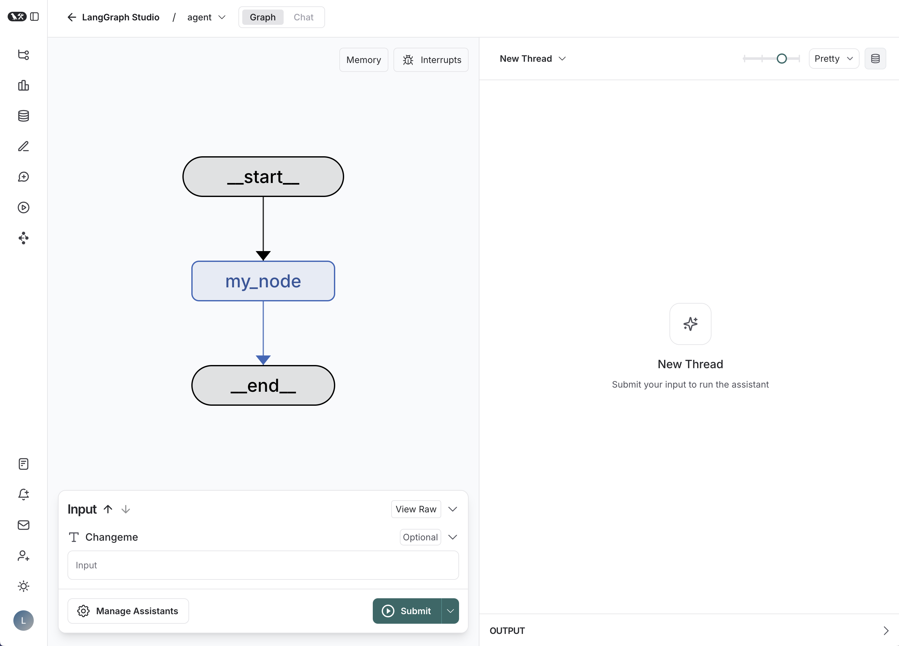

# New LangGraph Project

[](https://github.com/langchain-ai/new-langgraph-project/actions/workflows/unit-tests.yml)
[](https://github.com/langchain-ai/new-langgraph-project/actions/workflows/integration-tests.yml)

This project demonstrates a LangGraph agent that lets DeepSeek call EXA Search when a question requires current or external web information. It is designed to run with Agent Server and [LangSmith Studio](https://docs.langchain.com/langsmith/studio).

<div align="center">
  
</div>

The core logic in `src/agent/graph.py` uses an explicit `StateGraph` and
implements this loop:

```text
call_model -> review_tools -> tools -> call_model
     |             |            |
     |             |            +-- execute EXA without interrupt
     |             +-- interrupt, validate approve/edit/reject
     +-- direct answer -> END
```

The review and execution steps intentionally use separate graph nodes. A valid
decision is checkpointed before EXA runs, so an EXA exception cannot restore the
already-consumed interrupt. Invalid edited arguments are stored as
`review_error` and routed to a fresh `review_tools` task, which emits a new
interrupt containing the validation message instead of failing the run.

You can extend this graph to orchestrate more complex agentic workflows that can be visualized and debugged in LangGraph Studio.

## Getting Started

1. Install dependencies, along with the [LangGraph CLI](https://langchain-ai.github.io/langgraph/concepts/langgraph_cli/), which will be used to run the server.

```bash
cd path/to/your/app
pip install -e . "langgraph-cli[inmem]"
```

2. Configure the model and EXA credentials in `.env`:

```bash
DEEPSEEK_API_KEY=your-deepseek-api-key
EXA_API_KEY=your-exa-api-key
```

If you want to enable LangSmith tracing, add your LangSmith API key to the `.env` file.

```text
# .env
LANGSMITH_API_KEY=lsv2...
```

3. Start the LangGraph Server.

```shell
langgraph dev
```

Open the Studio URL printed by the CLI or connect
[Agent Chat UI](https://github.com/langchain-ai/agent-chat-ui) to
`http://localhost:2024` with assistant ID `agent`. Then try a message such as:

```text
请使用 EXA 搜索 LangGraph 最近发布的功能，并附上来源 URL。
```

The run pauses in `review_tools` before EXA is executed. The current official
Agent Chat UI recognizes the `action_requests` / `review_configs` interrupt
schema and sends a `decisions` resume payload automatically. After a valid
decision, `review_tools` completes and the separate `tools` node executes EXA.

The equivalent raw approval input is:

```json
{"decisions": [{"type": "approve"}]}
```

Selecting **Reject** skips EXA and returns the reason to the model:

```json
{"decisions": [{"type": "reject", "message": "不允许联网搜索"}]}
```

The UI also supports editing the query before approval:

```json
{
  "decisions": [
    {
      "type": "edit",
      "edited_action": {
        "name": "exa_search",
        "args": {"query": "LangGraph Agent Server 官方文档"}
      }
    }
  ]
}
```

Agent Server manages Studio checkpoint persistence, so the graph is intentionally
compiled without a manually-created `PostgresSaver`.

For more information on getting started with LangGraph Server, [see here](https://langchain-ai.github.io/langgraph/tutorials/langgraph-platform/local-server/).

## How to customize

1. **Define runtime context**: Modify the `Context` class in the `graph.py` file to expose the arguments you want to configure per assistant. For example, in a chatbot application you may want to define a dynamic system prompt or LLM to use. For more information on runtime context in LangGraph, [see here](https://langchain-ai.github.io/langgraph/agents/context/?h=context#static-runtime-context).

2. **Extend the graph**: The core logic of the application is defined in [graph.py](./src/agent/graph.py). You can modify this file to add new nodes, edges, or change the flow of information.

## Development

While iterating on your graph in LangGraph Studio, you can edit past state and rerun your app from previous states to debug specific nodes. Local changes will be automatically applied via hot reload.

Follow-up requests extend the same thread. You can create an entirely new thread, clearing previous history, using the `+` button in the top right.

For more advanced features and examples, refer to the [LangGraph documentation](https://langchain-ai.github.io/langgraph/). These resources can help you adapt this template for your specific use case and build more sophisticated conversational agents.

LangGraph Studio also integrates with [LangSmith](https://smith.langchain.com/) for more in-depth tracing and collaboration with teammates, allowing you to analyze and optimize your chatbot's performance.
